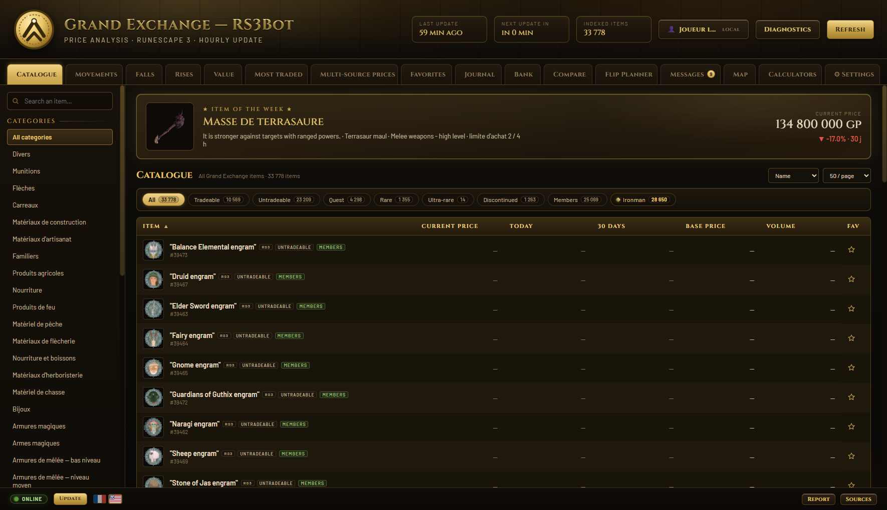
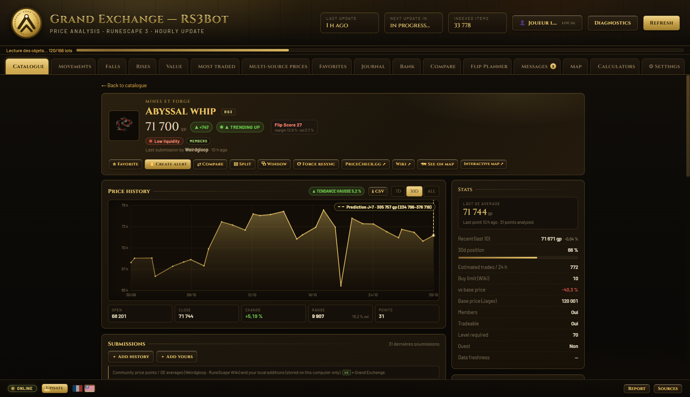
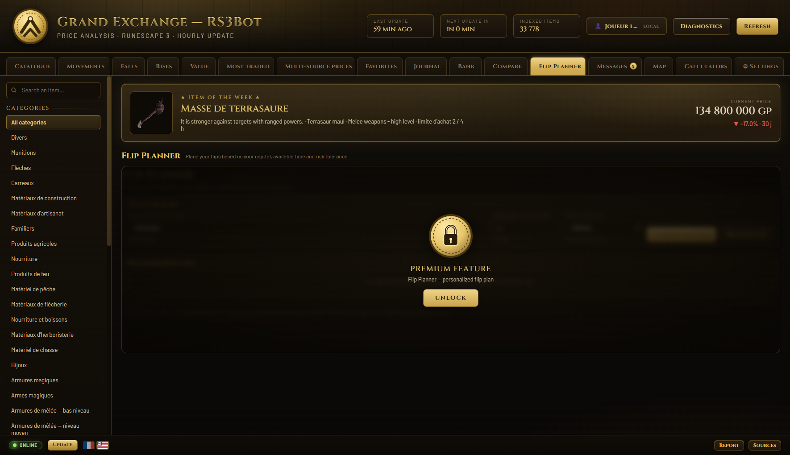
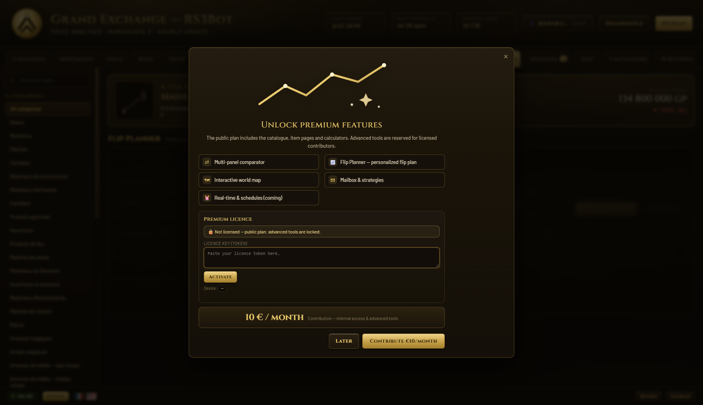

  

<h1 align="center">RS3Bot — L’intelligence du Grand Marché pour RuneScape 3</h1>

  <a href="README.md">🇬🇧 English</a> · <a href="README.fr.md">🇫🇷 Français</a>

  <em>Suivez les prix. Repérez les flips. Tradez plus intelligemment. Dans une application Windows native.</em>

  
  
  
  

  
  
  
  
  

  <a href="https://github.com/Tomoushie/RS3-BOT/releases/latest"><b>⬇️ Télécharger pour Windows</b></a>
  &nbsp;·&nbsp;
  <a href="#premium"><b>✨ Passer Premium</b></a>
  &nbsp;·&nbsp;
  <a href="https://github.com/Tomoushie/RS3-BOT/issues/new"><b>🐞 Signaler un bug</b></a>
  &nbsp;·&nbsp;
  <a href="mailto:nowaktombe@protonmail.com"><b>✉️ Contact</b></a>

---

## Qu’est-ce que RS3Bot ?

**RS3Bot** est un compagnon Windows natif pour le **Grand Marché de RuneScape 3**. Il transforme le catalogue GE en informations claires et actionnables : prix en direct, volumes réels, historique, opportunités de flip, planification des limites d’achat et **journal de trades local** — sans automatisation, sans macro et sans accès à votre compte.

Développé en **Rust + Tauri 2**, RS3Bot est rapide, léger et respectueux de la vie privée : **vos données ne quittent jamais votre ordinateur**. Aucun compte requis, aucune télémétrie, aucun cloud obligatoire.

> 🎯 **Lecture seule. Sûr. Local.** RS3Bot analyse des données publiques du Grand Marché. Il ne se connecte pas à votre compte de jeu et ne clique pas à votre place.

  

## Pourquoi RS3Bot ?

- **Plus de 33 000 objets indexés**, y compris non échangeables, quêtes, rares et discontinués.
- **Prix multi-sources** — Jagex, Weirdgloop et le wiki RuneScape, avec indicateur de fraîcheur et replis transparents.
- **Des outils de décision, pas juste des graphiques** — Flip Score, prix récent, position dans la range 30 j, alchimie, liquidité et suivi des limites d’achat.
- **Pensé pour les flippers** — profit par fenêtre de 4 h, marges nettes de taxe, classement basé sur le volume.
- **Votre journal de trading** — notes, taux de réussite, profit réalisé et performance par catégorie, stockés localement.
- **Premium là où ça compte** — comparateur avancé, carte interactive, actualités intégrées et Flip Planner.
- **Personnel et saisonnier** — thèmes Halloween/Noël/Nouvel An, profils locaux, curseur personnalisé et compagnon premium.

## Captures d’écran

  

<em>Analyse complète : historique, prédiction superposée, Flip Score, liquidité, alchimie et limite d’achat.</em>

  

<em>Flip Planner (premium) : capital, temps disponible et tolérance au risque — les meilleurs flips classés par profit par fenêtre de 4 h.</em>

## Fonctionnalités

### Gratuit pour toujours

| Fonctionnalité | Description |
|---|---|
| **Catalogue complet** | 33 778 objets, recherche, tags membres/quête/rare/discontinué/Ironman. |
| **Prix multi-sources** | Jagex, Weirdgloop et Wiki, avec fraîcheur et replis automatiques. |
| **Historique & prédictions** | Graphiques 7/30/180 j, tendance OLS, intervalle 80 %, ligne de prédiction. |
| **Flip Score & prix récent** | Score 0–100 (marge × volume ÷ volatilité) et moyenne des 10 dernières transactions. |
| **Liquidité & range 30 j** | Savoir si un objet se revend facilement et où il se situe dans sa range. |
| **Alchimie & limite d’achat** | Profit High/Low Alchemy et compteur de limite 4 h. |
| **Favoris, alertes & journal** | Alertes prix/volume/valeur de stock, journal avec taux de réussite. |
| **Calculateurs & carte** | Calculateurs, craft, PNJ/quêtes/zones, mini-carte du monde. |
| **FR / EN** | Interface complète en français et anglais, profils locaux, tutoriel. |

### Premium — pour les traders sérieux

| Fonctionnalité premium | Pourquoi elle est rentable |
|---|---|
| **Flip Planner** | Classe 3 à 5 flips par **profit net par fenêtre de 4 h**, selon votre capital, temps et risque. |
| **Comparateur avancé** | Jusqu’à 4 objets côte à côte : marges (taxe 2 %), volumes, tendances, range et graphiques superposés. |
| **Carte interactive** | Carte RuneScape par tuiles : banques, mines, pêche, fermes, autels, boutiques, maîtres Slayer, téléports. |
| **Boîte mail premium** | Alertes, stratégies, actualités wiki et astuces — avec lecture complète intégrée. |
| **Avant-première & support** | Nouvelles fonctionnalités en priorité, accès direct et early access. |

  

> **Premium : 10 € / mois.** Cela finance l’infrastructure de données, la maintenance et les nouvelles fonctionnalités. L’activation est **hors ligne et respectueuse de la vie privée** : une clé signée, aucun compte, aucune donnée bancaire stockée.

  <a href="mailto:nowaktombe@protonmail.com?subject=RS3Bot%20Premium"><b>✨ Demander une licence premium</b></a>

## Téléchargement & installation

1. Ouvrez la **[dernière release](https://github.com/Tomoushie/RS3-BOT/releases/latest)**.
2. Téléchargez :
   - **`RS3Bot_1.2.0_x64-setup.exe`** — installateur (recommandé), ou
   - **`RS3Bot_1.2.0_x64_en-US.msi`** — paquet MSI, ou
   - **`rs3-grand-market.exe`** — exécutable portable.
3. Lancez l’installateur puis **RS3Bot — Grand Marché**.
4. Premier lancement : indexation du catalogue puis tutoriel guidé. Les prix se mettent à jour toutes les heures.

> **Windows SmartScreen** : l’application n’est pas encore signée. Windows peut afficher « Windows a protégé votre PC ». Cliquez **Informations complémentaires → Exécuter quand même**. Les sommes SHA-256 sont publiées avec chaque release.

## Activation premium

RS3Bot utilise des **clés de licence hors ligne Ed25519** :

1. Recevez votre clé par email.
2. Ouvrez **Paramètres → Licence premium** ou cliquez sur **DÉBLOQUER**.
3. Collez la clé puis **Activer**.
4. Les fonctionnalités premium se déverrouillent immédiatement. La licence est locale et désactivable.

- **Aucun compte, aucun appel serveur** — vérification locale avec la clé publique embarquée.
- **Liaison appareil optionnelle** — une licence peut être liée à un PC.
- **Vie privée** — seuls le jeton de licence et un identifiant d’appareil aléatoire sont stockés localement.

## Confidentialité & sécurité

- **Données 100 % locales** : favoris, journal, banque, alertes, préférences et licences restent sur votre PC. Aucune télémétrie.
- **Aucun accès au compte de jeu** : RS3Bot ne demande jamais vos identifiants.
- **Aucune automatisation** : outil d’analyse en lecture seule.
- **Licences premium hors ligne** signées Ed25519 ; clé privée jamais embarquée.
- Voir [PRIVACY.md](PRIVACY.md) et [SECURITY.md](SECURITY.md).

## FAQ

**Est-ce autorisé par Jagex ?** RS3Bot lit uniquement des données publiques du Grand Marché, sans automatiser le jeu. Non affilié à Jagex. À utiliser selon les règles de RuneScape.

**Mac/Linux ?** La version actuelle cible **Windows 10/11 (x64)**.

**SmartScreen ?** Exécutable non signé pour l’instant ; vérifiez les SHA-256 puis lancez via *Informations complémentaires*.

**Connexion internet ?** Nécessaire pour les mises à jour de prix ; les données personnelles restent locales.

**Comment obtenir premium ?** Écrivez à **nowaktombe@protonmail.com** (objet *RS3Bot Premium*) pour recevoir une clé signée (10 € / mois).

**Un bug / une idée ?** Bouton **Signaler** dans l’application, [issue GitHub](https://github.com/Tomoushie/RS3-BOT/issues/new) ou email.

## Feuille de route

- ✅ Analyse GE multi-sources, univers d’objets, Flip Score, alertes, journal, cartes (v1.x)
- ✅ Flip Planner, licences premium, profils, notifications, tray
- 🚧 Support OSRS (second jeu de données + flux de prix)
- 🚧 Couverture complète de la carte (souterrains, donjons, bornes dédiées)
- 🚧 Keyforge/cloud licensing et early access

## Stack technique

Rust · Tauri 2 · JavaScript/CSS maison · Jagex itemdb · Weirdgloop · RuneScape Wiki

## Contribuer

- ⭐ **Star** le dépôt si RS3Bot vous fait gagner du temps.
- 🐞 **Signalez les bugs** via GitHub Issues ou le bouton **Signaler**.
- 💡 **Proposez des idées** par email ou issue.
- 🔐 **Vulnérabilités** : voir [SECURITY.md](SECURITY.md).

## Contact

- **Email :** nowaktombe@protonmail.com
- **Premium / commercial :** nowaktombe@protonmail.com
- **Bugs :** GitHub Issues ou bouton *Signaler*

---

  <b>RS3Bot</b> — L’intelligence du Grand Marché pour RuneScape 3. 
  Fait avec ❤️ pour la communauté RS3.

  RS3Bot n’est ni affilié, ni approuvé, ni associé à Jagex Ltd. RuneScape est une marque de Jagex Ltd. Tous les éléments du jeu appartiennent à leurs propriétaires respectifs. 
  Distribué sous licence MIT — voir <a href="LICENSE">LICENSE</a>.

