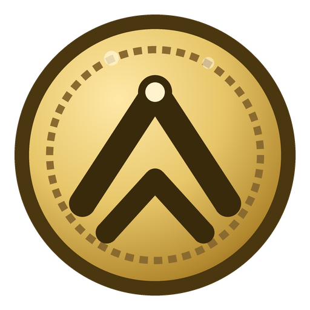
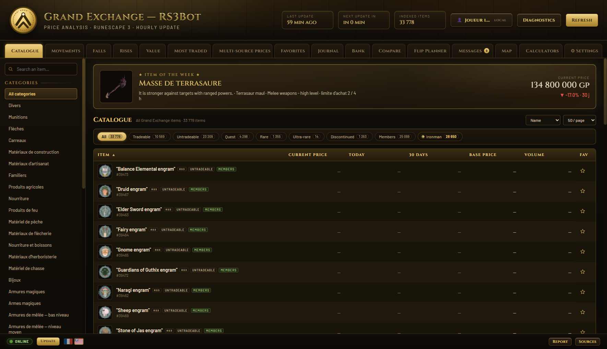
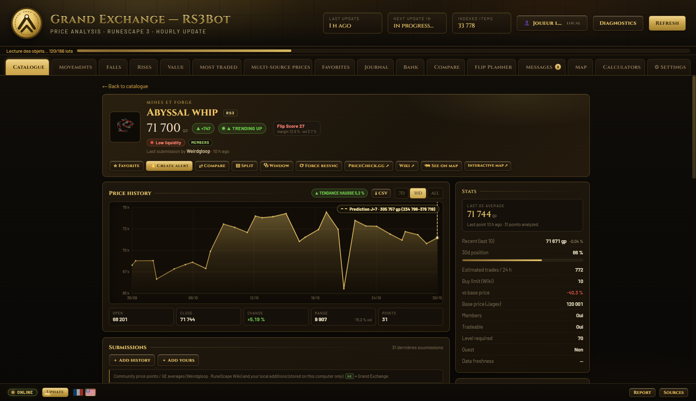
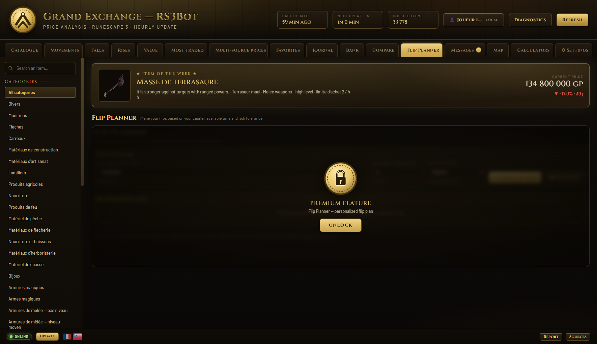
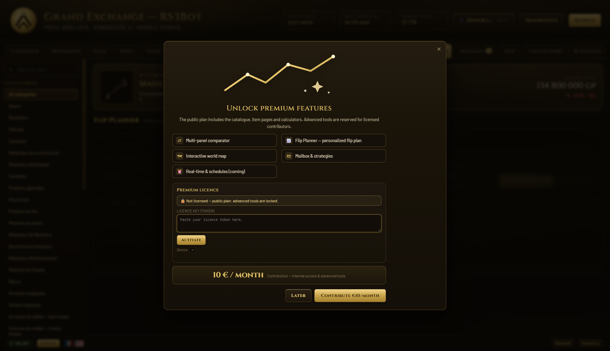

  

<h1 align="center">RS3Bot — Grand Exchange Intelligence for RuneScape 3</h1>

  <em>Track prices. Spot flips. Trade smarter. All in one native Windows app.</em>

  
  
  
  
  

  
  
  
  
  

  <a href="https://github.com/Tomoushie/RS3-BOT/releases/latest"><b>⬇️ Download for Windows</b></a>
  &nbsp;·&nbsp;
  <a href="#premium"><b>✨ Get Premium</b></a>
  &nbsp;·&nbsp;
  <a href="https://github.com/Tomoushie/RS3-BOT/issues/new"><b>🐞 Report a bug</b></a>
  &nbsp;·&nbsp;
  <a href="mailto:nowaktombe@protonmail.com"><b>✉️ Contact</b></a>

---

## What is RS3Bot?

**RS3Bot** is a native Windows companion for the **RuneScape 3 Grand Exchange**. It turns the overwhelming GE catalogue into clear, actionable information: live prices, real trading volume, price history, flip opportunities, buy-limit planning and **local trade journaling** — without automation, macros or account access.

Built with **Rust + Tauri 2**, RS3Bot is fast, lightweight and privacy-first: **your data never leaves your computer**. No account required, no telemetry, no cloud dependency.

> 🎯 **Read-only. Safe. Local.** RS3Bot analyses public Grand Exchange data. It does not log into your game account, does not click for you and does not automate gameplay.

  

## Why RS3Bot?

- **33,000+ items indexed** from the Grand Exchange, including untradeable, quest, rare and discontinued items.
- **Multi-source prices** — Jagex itemdb, Weirdgloop and the RuneScape Wiki, reconciled with transparent source status.
- **Decision tools, not just charts** — Flip Score, Recent trade price, 30-day range position, High/Low Alchemy, liquidity indicator and buy-limit tracker.
- **Built for real flippers** — profit per 4-hour buy-limit window, tax-aware margins, volume-aware ranking.
- **Your own trading journal** — notes, win rate, realised profit and performance by item category, stored locally.
- **Premium where it matters** — advanced comparator, interactive world map, in-app news, trade journal sync options and the Flip Planner.
- **Seasonal & personal** — holiday themes (Halloween, Christmas, New Year), local profiles, custom cursor and a small premium companion.

## Screenshots

  

<em>Complete item analysis: price history, prediction overlay, Flip Score, liquidity, alchemy and buy limits.</em>

  

<em>Flip Planner (premium): enter your capital, available time and risk tolerance — get the best flips ranked by profit per 4-hour window.</em>

## Features

### Free forever

| Feature | What it does |
|---|---|
| **Full Grand Exchange catalogue** | 33,778 items, searchable, with tags (members, quest, rare, discontinued, Ironman). |
| **Multi-source prices** | Jagex, Weirdgloop and Wiki prices with freshness indicators and automatic fallbacks. |
| **Price history & predictions** | 7/30/180-day charts, OLS trend, 80% confidence intervals, prediction line on the chart. |
| **Flip Score & Recent price** | Synthetic 0–100 flip score (margin × volume ÷ volatility) and last-10-trades average. |
| **Liquidity & range position** | Know if an item is easy to resell and where it sits in its 30-day range. |
| **Alchemy & buy-limit tools** | High/Low Alchemy profit and a 4-hour buy-limit tracker. |
| **Watchlist, alerts & journal** | Favourites, price/volume/stock-value alerts, personal trade journal with win rate. |
| **Calculators & map** | Skill calculators, Money-making, Craft, NPC/quest/zone database, curated world mini-map. |
| **FR / EN interface** | Full interface in French and English, local profiles and a first-run tutorial. |

### Premium — built for serious traders

| Premium feature | Why it pays for itself |
|---|---|
| **Flip Planner** | Ranks 3–5 flips by **net profit per 4-hour buy-limit window**, allocated to your capital, time and risk tolerance. |
| **Advanced Comparator** | Up to 4 items side by side: margins (2% GE tax), volume, trends, range position and normalised overlay charts. |
| **Interactive world map** | Tile-based RuneScape map with banks, mines, fishing spots, farms, altars, shops, slayer masters and teleports. |
| **Premium mailbox & strategies** | Price alerts, market strategies, wiki news and curated tips in one inbox — with full in-app news reading. |
| **Priority roadmap & support** | Premium features first, direct feedback channel and early access to new tools. |

  

> **Premium is 10 € / month.** It directly funds data infrastructure, maintenance and new features. Activation is **offline and privacy-friendly**: a signed license key, no account creation, no payment data stored in the app.

  <a href="mailto:nowaktombe@protonmail.com?subject=RS3Bot%20Premium"><b>✨ Request a premium license</b></a>

## Download & install

1. Open the **[latest release](https://github.com/Tomoushie/RS3-BOT/releases/latest)**.
2. Download either:
   - **`RS3Bot_1.2.0_x64-setup.exe`** — installer (recommended), or
   - **`RS3Bot_1.2.0_x64_en-US.msi`** — MSI package, or
   - **`rs3-grand-market.exe`** — portable executable.
3. Run the installer and launch **RS3Bot — Grand Marché**.
4. First launch: the app indexes the Grand Exchange catalogue and runs a guided tutorial. Prices refresh automatically every hour.

> **Windows SmartScreen**: the app is not code-signed (yet), so Windows may show “Windows protected your PC”. Click **More info → Run anyway**. You can verify the SHA-256 checksums published with each release.

## Premium activation

RS3Bot uses **offline Ed25519 license keys**:

1. Get your license key by email (see contact below).
2. Open **Settings → Premium license** or click **UNLOCK** on a premium tab.
3. Paste your license key and click **Activate**.
4. Premium features unlock instantly. The license is stored locally and can be deactivated at any time.

- **No account, no server call** — the licence is verified locally against the embedded public key.
- **Optional device binding** — licenses can be tied to one PC.
- **Respects your privacy** — only the license token and a random device ID are stored locally.

## How it works

| Source | Usage |
|---|---|
| **Jagex itemdb** | Official GE prices, buy limits, item metadata |
| **Weirdgloop** | Community prices, daily volumes, price history |
| **RuneScape Wiki** | Item metadata, recipes, NPC/quest/zone data, news |

- Refresh: **hourly automatic** + manual refresh.
- Cache: local `%APPDATA%\RS3Bot\cache.json` — no remote database required.
- Interfaces: French and English; prices displayed in full (e.g. `71 000 gp`, not `71k`).

## Privacy & security

- **100% local data.** Favourites, journal, bank, alerts, map preferences and licenses stay on your PC. No telemetry, no analytics, no tracking.
- **No game account access.** RS3Bot never asks for your RuneScape credentials.
- **No automation.** It is a read-only analysis tool — not a bot, macro or autoclicker.
- **Offline premium licensing.** Signed license keys with Ed25519; private signing key is never embedded in the app.
- See [PRIVACY.md](PRIVACY.md) and [SECURITY.md](SECURITY.md) for details.

## FAQ

**Is RS3Bot allowed by Jagex?**
RS3Bot only reads publicly available Grand Exchange data. It does not automate gameplay or interact with the game client. It is **not affiliated with or endorsed by Jagex**. Use at your own risk and follow the RuneScape rules.

**Does it work on Mac or Linux?**
The current release targets **Windows 10/11 (x64)**. Cross-platform builds may come later.

**Why is Windows SmartScreen warning me?**
The executable is currently unsigned (code-signing certificates are expensive). The source and checksums are published; click *More info → Run anyway* if you trust the release.

**Do I need an internet connection?**
Yes for price updates (public APIs). Your personal data and the app remain local.

**How do I get premium?**
Email **nowaktombe@protonmail.com** with the subject *RS3Bot Premium*. You will receive a signed license key (10 € / month) to activate in the app.

**I found a bug / I have an idea.**
Use **Report** in the app footer, open a [GitHub issue](https://github.com/Tomoushie/RS3-BOT/issues/new) or email us.

## Roadmap

- ✅ Multi-source GE analysis, item universe, Flip Score, alerts, journal, maps (v1.x)
- ✅ Flip Planner, premium licenses, profiles, notifications, tray support
- 🚧 OSRS support (second dataset + price feed)
- 🚧 Complete map coverage (underground plans, dungeons, dedicated bounds)
- 🚧 Keyforge/cloud licensing and early access

## Tech stack

- **Rust** — backend, scraping, caching, licensing, alerts
- **Tauri 2** — secure native Windows shell
- **Vanilla JS / CSS** — custom trading UI (no heavy web framework)
- **Data** — Jagex itemdb, Weirdgloop, RuneScape Wiki

## Contributing

- ⭐ **Star** the repository if RS3Bot saves you time.
- 🐞 **Report bugs** via GitHub Issues or the in-app **Report** button.
- 💡 **Suggest features** by email or issue.
- 🔐 **Report security issues privately** — see [SECURITY.md](SECURITY.md).

## Contact

- **Email:** nowaktombe@protonmail.com
- **Premium / commercial:** nowaktombe@protonmail.com
- **Bug reports:** GitHub Issues (or in-app *Report*)

---

  <b>RS3Bot</b> — Grand Exchange intelligence for RuneScape 3. 
  Made with ❤️ for the RS3 flipping community.

  RS3Bot is not affiliated with, endorsed by, or associated with Jagex Ltd. RuneScape is a trademark of Jagex Ltd. All in-game assets and names belong to their respective owners. 
  Released under the MIT License — see <a href="LICENSE">LICENSE</a>.

